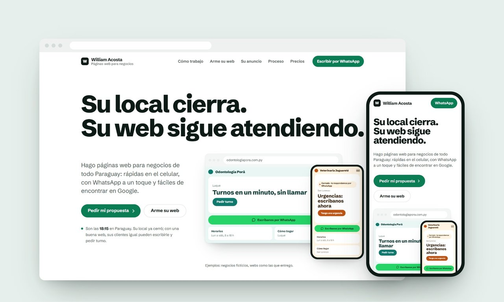
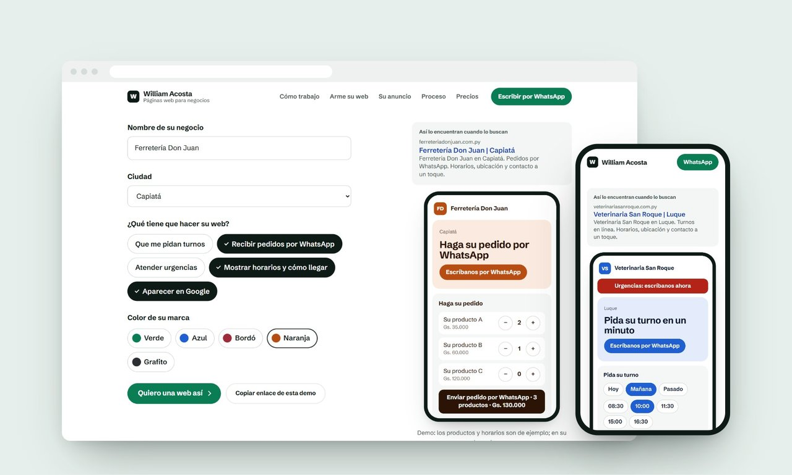

# Estudio de diseño web · William Acosta

Sitio de mi estudio de páginas web para negocios de Paraguay, hecho con **Next.js 16, React 19 y TypeScript**, exportado como sitio estático y publicado en **Cloudflare Workers**.

**En vivo:** https://william-acosta-web.web-estudio.workers.dev

*English: the website of my web design studio for small businesses in Paraguay. Next.js 16 static export, React 19, TypeScript, a live "build your site" demo, GSAP animations and an embedded Remotion video player, deployed on Cloudflare Workers.*



## Qué tiene

- **Portada con ejemplos en vivo**: una laptop y un celular muestran webs de ejemplo; el celular marca "Abierto" o "Cerrado" según la hora real de Paraguay.
- **"Arme su web en 30 segundos"**: el visitante escribe el nombre de su negocio, elige qué necesita (turnos, pedidos por WhatsApp, urgencias, horarios, Google) y un celular arma esa web en el momento. El resultado se manda por WhatsApp o se comparte como enlace (`?negocio=...#demo`) que abre la demo ya personalizada.
- **Animación ligada al scroll** (GSAP ScrollTrigger) que muestra cómo se reconstruye una web caída, pieza por pieza.
- **Video promocional personalizable** hecho con Remotion y reproducido dentro de la web con `@remotion/player`.
- **Páginas por rubro y por ciudad** (`/rubros/[rubro]`, `/diseno-web/[ciudad]`) y sección de precios, generadas desde datos en `src/data/`.
- **SEO técnico**: `sitemap.ts`, `robots.ts`, datos estructurados JSON-LD y metadatos por página.



## Calidad y rendimiento

Google Lighthouse en celular, sobre el sitio publicado (mediana de 3 corridas): **88 en rendimiento, 100 en accesibilidad, 100 en buenas prácticas y 100 en SEO**, sin desplazamientos de diseño (CLS 0).

- La portada se renderiza en el servidor; solo el reloj y el celular de ejemplo se hidratan, y la entrada es una animación CSS.
- GSAP se descarga recién cuando el navegador está libre, y las entradas por sección usan `IntersectionObserver` en lugar de un disparador de scroll por elemento.
- Las fuentes de los ejemplos se cargan al acercarse (`content-visibility`), así no compiten con el primer pintado.

## Estructura

```
src/
  app/          rutas (portada, /rubros/[rubro], /diseno-web/[ciudad]), sitemap y robots
  components/   secciones de la página (Hero, Builder, Rebuild, Pricing, AdStudio, ...)
  remotion/     composición del video promocional
  data/         contenido: rubros, ciudades, precios, datos de contacto
  lib/gsap.ts   carga diferida de GSAP (useIdleGsap)
PRODUCT.md, DESIGN.md   producto y sistema de diseño (tokens, componentes, reglas)
scripts/flatten-segments.mjs   ajuste posterior al build para la exportación estática
worker.js       worker de Cloudflare que sirve los archivos estáticos
```

## Uso

```bash
npm install
npm run dev       # desarrollo en http://localhost:3000
npm run build     # exportación estática en ./out
npm run deploy    # build + wrangler deploy a Cloudflare
```

El número de WhatsApp y la URL del sitio se configuran en `src/data/site.ts`.
